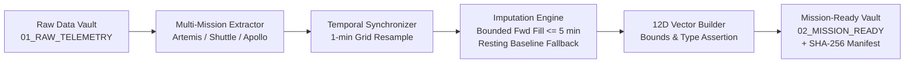

# ASTROVITAL AI : VITALX CORE (RECREATED V1)
## SUBSYSTEM 01: DATA VAULT — 12-DIMENSIONAL TELEMETRY SCHEMA SPECIFICATION
### FLIGHT-READY TELEMETRY DEFINITION & PHYSICAL BOUNDARY CONSTRAINTS

---

```
================================================================================
 SPECIFICATION DESIGNATOR: ASTROVITAL-SPEC-DATA-12D
 SUBSYSTEM LOCATION: 01_DATA_VAULT/ & 02_AI_CORE/01_src/ingestion_adapter.py
 CERTIFICATION STANDARD: DO-178C LEVEL C (DAL C)
 DATA SCHEMA VECTOR: X(t) in R^12 (N x 12 float64 Tensor)
 ARCHITECT & LEAD: TEAM VITALX CORE
 DATE OF RATIFICATION: NOVEMBER 14, 2026
================================================================================
```

---

## 1. Scope & Aeronautical Flight Context

The standardized **12-Dimensional Telemetry Vector** $\mathbf{X}(t) \in \mathbb{R}^{12}$ is the fundamental data contract across the entire ASTROVITAL decision support architecture. Derived from multi-mission operational flight archives (Artemis II Orion multi-channel sensors, Space Shuttle DSO cardiovascular profiles, and Apollo 7 clinical monitoring), this schema harmonizes disparate sampling rates, analog sensor variations, and temporal gaps into a unified, cryptographically auditable time-series representation.

---

## 2. 12-Dimensional Feature Definition & Physical Bounds

Under DO-178C Level C defensive engineering, every biological parameter is bounded by strict, non-negotiable physical envelopes:

$$\mathbf{X}(t) = \begin{bmatrix} x_1(t) & x_2(t) & \dots & x_{12}(t) \end{bmatrix}^T$$

| Vector Index | Feature Name | Description & Clinical Significance | Sensor Source & Transducer | Standard SI Unit | Physical Valid Range $[\text{Min}, \text{Max}]$ | Nominal Resting Baseline |
| :---: | :--- | :--- | :--- | :---: | :---: | :---: |
| **0** | `heart_rate` | Cardiac chronotropic frequency; indicates cardiovascular strain, autonomic arousal, or deconditioning. | 3-Lead ECG / Optical PPG harness | $\text{bpm}$ | $[30.0, 220.0]$ | $70.0$ |
| **1** | `blood_pressure_systolic` | Peak arterial pressure during left ventricular ejection ($\text{SBP}$). Sensitive to cephalad fluid shift. | Finapres continuous plethysmography | $\text{mmHg}$ | $[70.0, 240.0]$ | $120.0$ |
| **2** | `blood_pressure_diastolic` | Minimum arterial pressure during ventricular diastole ($\text{DBP}$). Critical for MAP computation. | Continuous finger arterial cuff | $\text{mmHg}$ | $[40.0, 140.0]$ | $80.0$ |
| **3** | `rmssd` | Root Mean Square of Successive RR interval Differences; parasympathetic vagal tone marker. | High-resolution R-peak detection | $\text{ms}$ | $[5.0, 250.0]$ | $42.0$ |
| **4** | `spo2` | Functional arterial blood oxygen saturation. Primary hypoxia indicator. | Dual-wavelength pulse oximeter | $\%$ | $[50.0, 100.0]$ | $98.0$ |
| **5** | `core_temp` | Core body temperature ($T_c$). Indicates thermoregulatory disruption or space fever. | Tympanic IR / ingested radio pill | $^\circ\text{C}$ | $[34.0, 42.0]$ | $37.0$ |
| **6** | `blood_glucose` | Circulating blood glucose concentration; metabolic fuel availability. | Continuous Glucose Monitor (CGM) | $\text{mg/dL}$ | $[40.0, 400.0]$ | $95.0$ |
| **7** | `sleep_deficit_hours` | Cumulative sleep debt over a rolling 72-hour mission window; cognitive fatigue driver. | Actigraphy + Polysomnography log | $\text{hours}$ | $[0.0, 48.0]$ | $0.0$ |
| **8** | `reaction_latency_ms` | Psychomotor vigilance reaction time (PVT). Quantifies neuro-vestibular impairment. | Astronaut interactive flight terminal | $\text{ms}$ | $[150.0, 1500.0]$ | $240.0$ |
| **9** | `microgravity_days` | Elapsed mission duration in continuous microgravity ($\mu g$ exposure). Drives fluid redistribution. | Mission Elapsed Time (MET) clock | $\text{days}$ | $[0.0, 1000.0]$ | $0.0$ |
| **10** | `cabin_co2_mmhg` | Orion/Station environmental cabin $P_{\text{cabin}}^{\text{CO}_2}$. Hypercapnic cerebral vasodilator. | Orion Environmental Micro-logger | $\text{mmHg}$ | $[0.0, 15.0]$ | $2.5$ |
| **11** | `accel_magnitude_g` | Total body acceleration vector magnitude; distinguishes EVA, exercise, and microgravity drift. | 3-Axis wearable accelerometer | $g$ | $[0.0, 10.0]$ | $0.0$ |

---

## 3. Data Transformation & Ingestion Pipeline



### 3.1 Bounded Imputation Rules
1. **Short Gaps ($\le 5\text{ minutes}$):** Imputed via zero-order forward fill (`ffill(limit=5)`), preserving the last known physiologically valid telemetry sample.
2. **Extended Dropouts ($> 5\text{ minutes}$):** Imputed using calibrated resting baselines from the table above. An alert bit is logged in the telemetry metadata manifest.
3. **Null Rejection:** If any column in $\mathbf{X}(t)$ retains a `NaN` or `None` after imputation, `TelemetryVector12DBuilder` raises a fatal `ValueError` and inhibits pipeline execution.

### 3.2 Cryptographic Tamper-Evidence
Every exported dataset `01_DATA_VAULT/02_MISSION_READY/<dataset_name>.csv` is accompanied by an immutable sidecar manifest `<dataset_name>.json`:
```json
{
  "dataset_name": "mission_ready_telemetry_stream.csv",
  "sha256": "e3b0c44298fc1c149afbf4c8996fb92427ae41e4649b934ca495991b7852b855",
  "total_records": 1440,
  "vector_dimension": 12,
  "standard": "DO-178C DAL C",
  "export_timestamp": "2026-11-14T06:15:00Z"
}
```

---

## 4. Requirement Verification Traceability

- **`HLR-BIO-001`**: Multi-mission raw telemetry extraction verified via `test_phase2_*`.
- **`HLR-BIO-003`**: Defensive bounds checking and bounded imputation verified via `test_phase3_*` and `test_phase4_*`.
- **`HLR-BIO-004`**: Cryptographic integrity and SHA-256 manifest generation verified via `test_phase5_*`.

**Status:** Formally verified and sealed under DO-178C Level C.
