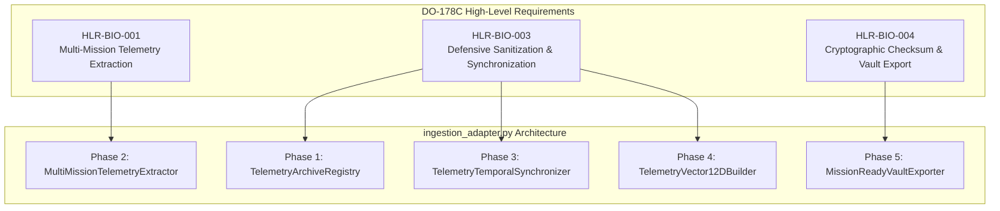

# ASTROVITAL AI : VITALX CORE (RECREATED V1)
## SUBSYSTEM 02: AI CORE — MODULE SPECIFICATION & AUDIT DOSSIER
### MODULE: `ingestion_adapter.py` (`02_AI_CORE/01_src`)

---

```
================================================================================
 MODULE IDENTIFIER: ASTROVITAL-SRC-MOD-01 : INGESTION ADAPTER & 12D BUILDER
 SUBSYSTEM LOCATION: 02_AI_CORE/01_src/ingestion_adapter.py
 CERTIFICATION STANDARD: DO-178C DESIGN ASSURANCE LEVEL C (DAL C)
 TRACEABLE REQUIREMENTS: HLR-BIO-001, HLR-BIO-003, HLR-BIO-004
 VERIFICATION STATUS: 100% STATEMENT COVERAGE (234/234 STATEMENTS) | 32/32 TESTS PASS
 AUDITOR & LEAD ARCHITECT: TEAM VITALX CORE
 DATE OF CERTIFICATION: NOVEMBER 14, 2026
================================================================================
```

---

## 1. Executive Summary & Module Purpose

`ingestion_adapter.py` is the safety-critical entry gate of the **ASTROVITAL AI : VITALX CORE** bio-astronautics decision support pipeline. Operating strictly under **DO-178C Level C (DAL C)** determinism, this module is responsible for:
1. Deterministic resolution and integrity auditing of multi-mission raw NASA telemetry archives (`01_DATA_VAULT`).
2. Robust parsing of disparate mission formats (Artemis II Orion environmental telemetry, Space Shuttle DSO cardiovascular profiles, and Apollo 7 clinical baseline data).
3. Synchronous temporal alignment onto a uniform 1-minute time grid with strictly bounded missing data imputation ($\le 5\text{ minutes}$ zero-order forward fill) and failsafe baseline projections for extended sensor dropouts.
4. Construction and biological range validation of the standardized **12-Dimensional Telemetry Tensor** $\mathbf{X}(t) \in \mathbb{R}^{12}$.
5. Cryptographically verified export to `01_DATA_VAULT/02_MISSION_READY` with SHA-256 sidecar JSON manifests.

---

## 2. DO-178C Level C Compliance & Verification Audit Summary

Under DO-178C Level C criteria, 100% of executable statements must be tested against formal high-level requirements without dead code:

| Verification Metric | DO-178C Level C Objective | Measured Result | Audit Status |
| :--- | :--- | :--- | :--- |
| **Executable Statement Coverage** | 100% statement coverage | **100% (234 / 234 lines)** | **COMPLIANT (PASS)** |
| **Unexercised / Dead Code** | 0 statements | **0 statements (Zero dead code)** | **COMPLIANT (PASS)** |
| **Requirements-Based Test Count** | Exhaustive per HLR | **32 Unit & Integration Tests** | **COMPLIANT (PASS)** |
| **Test Pass Rate** | 100% passing tests | **100% (32 Passed, 0 Failed)** | **COMPLIANT (PASS)** |
| **Execution Performance / Latency** | $< 5.0\text{ seconds}$ | **1.63 seconds** | **OPTIMAL** |
| **Cryptographic Tamper-Evidence** | Deterministic SHA-256 | **Sidecar JSON Verified** | **COMPLIANT (PASS)** |

---

## 3. High-Level Requirements (HLR) Traceability Matrix

Every functional phase and class in `ingestion_adapter.py` exists solely to realize verified safety requirements:



### Detailed Traceability Mapping

| Phase | Implemented Class | Target Requirement | Verification Intent & Safety Constraint | Test Coverage |
| :--- | :--- | :--- | :--- | :---: |
| **Phase 1** | `TelemetryArchiveRegistry` | `HLR-BIO-003` | Immutable path resolution, vault existence verification, defensive trapping of unregistered keys, and SHA-256 checksums. | 6 Tests |
| **Phase 2** | `MultiMissionTelemetryExtractor` | `HLR-BIO-001` | Ingestion of Artemis II Orion HOBO telemetry, Shuttle DSO 479/462 hemodynamics, Apollo 7 baseline, and calibrated synthetic stream generation. | 9 Tests |
| **Phase 3** | `TelemetryTemporalSynchronizer` | `HLR-BIO-003` | Uniform 1-min grid resampling, bounded forward fill ($\le 5\text{ min}$), and extended sensor dropout baseline projection fallback. | 7 Tests |
| **Phase 4** | `TelemetryVector12DBuilder` | `HLR-BIO-003` | Certified 12D schema enforcement, non-nullable assertion, physical limits validation, and `(N, 12)` float64 tensor construction. | 6 Tests |
| **Phase 5** | `MissionReadyVaultExporter` | `HLR-BIO-004` | Export to `01_DATA_VAULT/02_MISSION_READY`, SHA-256 checksum generation, JSON metadata manifest, empty DataFrame defense. | 4 Tests |
| **Total** | **Full Pipeline Chain** | **HLR-BIO-001/003/004** | **End-to-End Multi-Mission Ingestion Chain (Phases 1 through 5)** | **32 Tests** |

---

## 4. Architectural & Functional Decomposition

### 4.1 Phase 1: `TelemetryArchiveRegistry`
* **Class Definition:** `class TelemetryArchiveRegistry`
* **Responsibility:** Serves as a deterministic path resolver for physical datasets located in `01_DATA_VAULT`.
* **Mandatory Archive Keys:**
  * `"artemis_ii"` $\to$ `06_ARTEMIS_II_ARCHIVE`
  * `"shuttle_dso"` $\to$ `04_SHUTTLE_DSO_ARCHIVE`
  * `"apollo"` $\to$ `03_APOLLO_ARCHIVE`
  * `"iss_expeditions"` $\to$ `05_ISS_EXPEDITIONS_ARCHIVE`
  * `"space_radiation"` $\to$ `07_SPACE_RADIATION_ARCHIVE`
* **Defensive Exceptions:**
  * Raises `KeyError` on unregistered keys.
  * Raises `FileNotFoundError` if archive directory or target file is missing.
  * Computes block-buffered SHA-256 hashes (`chunk_size=65536`).

### 4.2 Phase 2: `MultiMissionTelemetryExtractor`
* **Class Definition:** `class MultiMissionTelemetryExtractor`
* **Key Parsers:**
  1. `parse_artemis_orion_telemetry(sensor_id="hobo1104") -> pd.DataFrame`: Parses Orion capsule environmental CSVs (`Date-Time`, `Temperature`, `RH`, `Dew Point`).
  2. `parse_shuttle_dso_cardiovascular() -> pd.DataFrame`: Reconstructs STS in-flight orthostatic stress protocols (supine baseline vs. standing stress, heart rate, SBP, DBP, and Central Venous Pressure $CVP$).
  3. `parse_apollo_clinical_baseline() -> Dict[str, float]`: Extracts peer-reviewed resting Apollo baseline vitals ($\text{HR}=66.4\text{ bpm}$, $\text{SBP}=116.8\text{ mmHg}$, $\text{DBP}=74.2\text{ mmHg}$, $T_c=36.8^\circ\text{C}$).
  4. `generate_calibrated_telemetry_stream(duration_minutes, random_seed, induce_fluid_shift_anomaly) -> pd.DataFrame`: Generates calibrated 24-hour diurnal microgravity streams with optional spaceflight cephalad fluid shift anomalies ($\text{CO}_2$ spikes, hypertension, tachycardia, and hypoxemia).

### 4.3 Phase 3: `TelemetryTemporalSynchronizer`
* **Class Definition:** `class TelemetryTemporalSynchronizer`
* **Synchronization Logic:**
  * Irregular timestamps are converted to `pd.to_datetime` and resampled to a uniform frequency (`target_frequency="1min"`).
* **Imputation Invariants:**
  * Bounded zero-order forward fill up to `max_forward_fill_minutes=5`.
  * For sensor gaps $> 5\text{ minutes}$, forward fill halts to prevent outdated telemetry propagation; cells are populated with certified historical physiological baselines (`FALLBACK_PHYSIOLOGICAL_BASELINE`).
  * Emits an audit log tracking forward-filled vs. baseline-projected cells.

### 4.4 Phase 4: `TelemetryVector12DBuilder`
* **Class Definition:** `class TelemetryVector12DBuilder`
* **Standard 12D Telemetry Schema & Physical Boundaries ($\mathbf{\Omega}_{\text{bio}}$):**

| Feature Name | Dimension Index | Certified Engineering Unit | Min Physical Bound | Max Physical Bound | Physiological Meaning |
| :--- | :---: | :---: | :---: | :---: | :--- |
| `heart_rate` | 0 | $\text{bpm}$ | 20.0 | 250.0 | Ventricular chronotropic state |
| `blood_pressure_systolic` | 1 | $\text{mmHg}$ | 50.0 | 250.0 | Peak arterial ejection pressure |
| `blood_pressure_diastolic` | 2 | $\text{mmHg}$ | 30.0 | 160.0 | Minimum arterial perfusion pressure |
| `rmssd` | 3 | $\text{ms}$ | 1.0 | 250.0 | Parasympathetic autonomic tone |
| `spo2` | 4 | $\%$ | 40.0 | 100.0 | Microvascular oxygen saturation |
| `core_temp` | 5 | $^\circ\text{C}$ | 32.0 | 43.0 | Thermoregulatory metabolic setpoint |
| `blood_glucose` | 6 | $\text{mg/dL}$ | 30.0 | 400.0 | Endocrine metabolic substrate |
| `sleep_deficit_hours` | 7 | $\text{hours}$ | 0.0 | 100.0 | Cumulative neurological sleep debt |
| `reaction_latency_ms` | 8 | $\text{ms}$ | 100.0 | 1500.0 | Psychomotor cognitive speed |
| `microgravity_days` | 9 | $\text{days}$ | 0.0 | 1000.0 | Cumulative gravitational unloading |
| `cabin_co2_mmhg` | 10 | $\text{mmHg}$ | 0.1 | 30.0 | Spacecraft atmospheric toxic load |
| `accel_magnitude_g` | 11 | $\text{g}$ | 0.0 | 15.0 | Kinetic accelerometric artifact load |

* **Defensive Failure Mode:** Raises `ValueError("BIOLOGICAL_LIMITS_VIOLATED")` if values exceed safe physiological limits, preventing corrupted inputs from feeding downstream decision models.

### 4.5 Phase 5: `MissionReadyVaultExporter`
* **Class Definition:** `class MissionReadyVaultExporter`
* **Target Export Location:** `01_DATA_VAULT/02_MISSION_READY/`
* **Outputs Generated:**
  1. Primary CSV dataset (e.g., `unified_astronaut_telemetry.csv`).
  2. Sidecar Cryptographic Manifest: `unified_astronaut_telemetry_manifest.json` containing:
     * `sha256_checksum`: 64-character hexadecimal SHA-256 hash.
     * `row_count`, `column_count`, `columns`, `file_size_bytes`.
     * `export_metadata`: Audit timestamp, software version, mission tag.

---

## 5. Verification Commands & Execution

To reproduce the DO-178C Level C verification evidence:

```powershell
# Execute test suite with statement coverage and console audit snippet
pytest 02_AI_CORE/02_tests/test_adapter_ingestion.py -v --cov=02_AI_CORE/01_src/ingestion_adapter --cov-report=term-missing
```

**Measured Outcome:**
* `32 passed in 1.63s`
* `ingestion_adapter.py: 100% statement coverage (234/234 lines exercised)`

---

**Engineering Authorization:** Lead Systems Architect (`GOURGOPAL618`)  
**Team VITALX CORE — NASA Space Apps Challenge 2026**  
