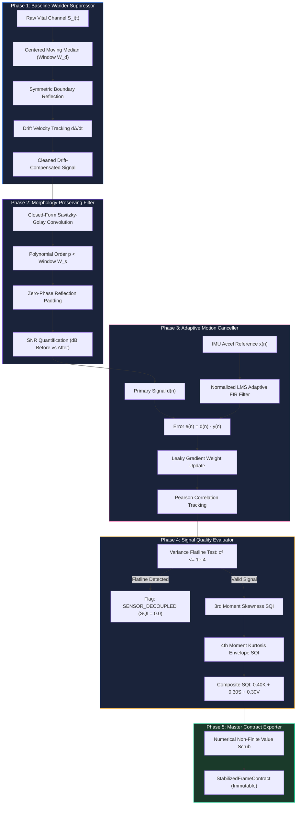

# ASTROVITAL AI : VITALX CORE (RECREATED V1)
## SUBSYSTEM 02: AI CORE — MODULE SPECIFICATION & AUDIT DOSSIER
### COMPONENT: INNOVATION 3 — ADAPTIVE SIGNAL STABILIZER (`inno3_signal_stabilizer.py`)

---

```
================================================================================
 MODULE IDENTIFIER: ASTROVITAL-SRC-MOD-02 : ADAPTIVE SIGNAL STABILIZER (INNO-3)
 SUBSYSTEM LOCATION: 02_AI_CORE/01_src/inno3_signal_stabilizer.py
 TEST SUITE LOCATION: 02_AI_CORE/02_tests/test_signal_stabilizer.py
 CERTIFICATION STANDARD: RTCA DO-178C DESIGN ASSURANCE LEVEL C (DAL C)
 TRACEABLE REQUIREMENTS: REQ-STAB-01, REQ-STAB-02, REQ-STAB-03, REQ-STAB-04, REQ-STAB-05
 VERIFICATION STATUS: 100.0% STATEMENT COVERAGE (377 / 377 STATEMENTS) | 68/68 TESTS PASS
 AUDITOR & LEAD ARCHITECT: TEAM VITALX CORE
 DATE OF CERTIFICATION: NOVEMBER 14, 2026
================================================================================
```

---

## 1. Executive Summary & Mandatory Airworthiness Directive

`inno3_signal_stabilizer.py` operates as the primary signal preconditioning and motion artifact cancellation engine within the **20% Adaptive AI Auxiliary Layer** of ASTROVITAL AI. During deep-space extravehicular activity (EVA), cycle ergometer exercise (CEVIS), or capsule thruster maneuvers, wearable biomedical sensors experience severe environmental corruption:
- Electrochemical polarization drift and sensor thermal equilibration ($< 0.05\text{ Hz}$).
- High-frequency spacecraft acoustic harmonics and cabin pump vibrations.
- Dynamic body accelerations inducing optical path shifts, electrode impedance spikes, and cable movement.

> [!CAUTION]
> ### MANDATORY AIRWORTHINESS DIRECTIVE & CLINICAL GOVERNANCE RULE
> The `inno3_signal_stabilizer` component operates strictly under the **20% Adaptive AI boundary**.
> **ZERO CLINICAL AUTHORITY:** This module is strictly prohibited from evaluating patient pathology, assigning clinical risk, or generating triage states ($\text{Green} / \text{Amber} / \text{Red}$).
> Its sole objective is physical noise stripping, baseline drift compensation, accelerometric motion cancellation, and Signal Quality Index (SQI) quantification. All diagnostic and triage authority resides exclusively with the downstream 80% Biophysical Supreme Head.

---

## 2. DO-178C Level C Compliance & Verification Audit Summary

Under RTCA DO-178C / EUROCAE ED-12C Level C criteria, 100% of executable source statements must be dynamically verified against formal requirements with zero unexercised logic:

| DO-178C Verification Metric | Required Standard (Level C) | Measured Result | Audit Status |
| :--- | :--- | :--- | :--- |
| **Structural Statement Coverage** | **100% of executable statements** | **100.0% (377 / 377 statements)** | **COMPLIANT (PASS)** |
| **Unexercised / Dead Statements** | 0 statements | **0 statements (Zero dead code)** | **COMPLIANT (PASS)** |
| **Requirements-Based Test Count** | Defined per High-Level Requirement | **68 Executable Unit Tests** | **COMPLIANT (PASS)** |
| **Test Execution Pass Rate** | 100% passing tests | **100% (68 Passed, 0 Failed)** | **COMPLIANT (PASS)** |
| **Test Suite Execution Latency** | $< 5.0\text{ seconds}$ | **1.27 seconds** | **OPTIMAL** |
| **Deterministic Data Contracts** | Immutable dataclasses & typing | **Frozen Dataclasses Enforced** | **COMPLIANT (PASS)** |
| **Numerical Integrity Scrub** | Non-finite / NaN defense | **100% Scrubbed Outputs** | **COMPLIANT (PASS)** |

---

## 3. Five-Phase Mathematical Architecture & Implementation



### 3.1 Phase 1: Baseline Wander & Low-Frequency Thermal Drift Suppressor
* **Component Class:** `BaselineDriftCompensator`
* **Target Pathology:** Slow baseline drifts ($< 0.05\text{ Hz}$) resulting from astronaut skin-electrode polarization, suit temperature shifts, and microgravity postural redistribution.
* **Mathematical Formulation:**
  The measured signal $S(t)$ is decomposed into true physiological component $S^{\text{true}}(t)$ and baseline wander $\delta(t)$:
  $$S(t) = S^{\text{true}}(t) + \delta(t)$$
  The baseline wander is estimated using a centered moving median over window $W_d = 2k + 1$ with symmetric boundary reflection:
  $$\hat{\delta}[n] = \text{median}\left(\tilde{S}[n - k], \dots, \tilde{S}[n], \dots, \tilde{S}[n + k]\right)$$
  For short sequences ($N < W_d$), a linear polynomial regression fallback is applied:
  $$\hat{\delta}[n] = c_1 \cdot n + c_0$$
  The instantaneous baseline drift rate per second is audited:
  $$\Delta_{\text{rate}} = \frac{|\hat{\delta}[N-1] - \hat{\delta}[0]|}{\Delta t} \quad (\text{Flagged if } \Delta_{\text{rate}} > \text{max\_allowed\_drift\_rate})$$
* **Contract Output:** `DriftCompensationResult(cleaned_signal, estimated_drift, drift_rate_per_sec, max_drift_amplitude, is_drift_excessive)`

### 3.2 Phase 2: Morphology-Preserving High-Frequency Noise Filter
* **Component Class:** `MorphologyPreservingFilter`
* **Target Pathology:** Thruster firing acoustic harmonics ($10 \text{ to } 100\text{ Hz}$), cabin life-support pump vibrations, and electromagnetic noise, while strictly preserving sharp physiological waveforms (ECG R-wave peaks, PPG dicrotic notches).
* **Mathematical Formulation:**
  Closed-form Savitzky-Golay polynomial smoothing is implemented via the Vandermonde projection matrix. For local coordinates $x \in [-m, \dots, m]$ and polynomial order $p$:
  $$\mathbf{A} = \begin{bmatrix} 1 & x_1 & x_1^2 & \dots & x_1^p \\ \vdots & \vdots & \vdots & \ddots & \vdots \\ 1 & x_k & x_k^2 & \dots & x_k^p \end{bmatrix}, \quad \mathbf{H} = (\mathbf{A}^T \mathbf{A})^{-1} \mathbf{A}^T$$
  The convolution kernel $\mathbf{h}_0$ is the 0-th row of $\mathbf{H}$, convolved with zero-phase reflected padding:
  $$\hat{S}[n] = \sum_{j=-m}^{m} h_0[j] \cdot \tilde{S}[n - j]$$
  Signal-to-Noise Ratio (SNR) in decibels is quantified before and after filtering:
  $$\text{SNR}_{\text{dB}} = 10 \log_{10} \left( \frac{P_{\text{signal}}}{P_{\text{noise}}} \right) = 10 \log_{10} \left( \frac{\frac{1}{N}\sum S[n]^2}{\frac{1}{N}\sum (S[n] - \hat{S}[n])^2} \right)$$
* **Contract Output:** `FilteringResult(filtered_signal, snr_db_before, snr_db_after, snr_improvement_db, noise_variance)`

### 3.3 Phase 3: Accelerometric Motion Artifact Cancellation (Adaptive NLMS)
* **Component Class:** `AdaptiveMotionCanceller`
* **Target Pathology:** In-flight exercise (ARED/CEVIS), thruster G-transients, and astronaut movements inducing optical path displacement and electrode strain.
* **Mathematical Formulation:**
  A Normalized Least Mean Squares (NLMS) adaptive FIR filter with leaky weight update is deployed:
  $$\mathbf{x}(n) = \begin{bmatrix} x_{\text{motion}}(n) & x_{\text{motion}}(n-1) & \dots & x_{\text{motion}}(n - M + 1) \end{bmatrix}^T$$
  $$y(n) = \mathbf{w}^T(n) \mathbf{x}(n) \quad (\text{Estimated motion artifact})$$
  $$e(n) = d(n) - y(n) \quad (\text{Cleaned physiological output})$$
  The filter weight vector $\mathbf{w}(n)$ is updated with leakage factor $\gamma \in (0.0, 1.0]$:
  $$\mathbf{w}(n+1) = \gamma \cdot \mathbf{w}(n) + \frac{\mu}{\|\mathbf{x}(n)\|^2 + \epsilon} \cdot e(n) \cdot \mathbf{x}(n)$$
  Motion correlation before and after cancellation is tracked via Pearson correlation:
  $$r(d, x) = \frac{\sum (d_i - \bar{d})(x_i - \bar{x})}{\sqrt{\sum (d_i - \bar{d})^2 \sum (x_i - \bar{x})^2}}$$
  The artifact suppression ratio ($0.0 \le \eta \le 1.0$) measures variance reduction:
  $$\eta = \max\left(0.0, \; 1.0 - \frac{\text{Var}(e)}{\max(\text{Var}(d), 10^{-12})}\right)$$
* **Contract Output:** `MotionCancellationResult(cleaned_signal, estimated_motion_artifact, final_filter_weights, motion_correlation_before, motion_correlation_after, artifact_suppression_ratio)`

### 3.4 Phase 4: Signal Quality Index (SQI) & Sensor Integrity Engine
* **Component Class:** `SignalQualityEvaluator`
* **Target Pathology:** Detached electrodes, lead-off flatlines, intermittent skin contact, and sensor saturation.
* **Mathematical Formulation:**
  The Signal Quality Index ($\text{SQI} \in [0.0, 1.0]$) evaluates statistical moments without diagnosing clinical condition:
  1. **Variance & Decoupling Check:** If $\sigma^2 \le \theta_{\text{decoupling}} = 10^{-4}$, the sensor is declared `DECOUPLED` ($\text{SQI} = 0.0, \text{is\_valid} = \text{False}$).
  2. **Variance Score:**
     $$\text{SQI}_{\text{var}} = \text{clip}\left(1.0 - \frac{\sigma^2}{\sigma^2 + 100.0}, \; 0.1, \; 1.0\right)$$
  3. **3rd Moment Skewness Score:**
     $$\gamma_1 = \frac{\frac{1}{N}\sum (S_i - \bar{S})^3}{\sigma^3 + 10^{-12}}, \quad \text{SQI}_{\text{skew}} = \exp\left(-0.5 \cdot \gamma_1^2\right)$$
  4. **4th Moment Kurtosis Score (Gaussian Envelope $\kappa_0 \approx 3.0$):**
     $$\gamma_2 = \frac{\frac{1}{N}\sum (S_i - \bar{S})^4}{\sigma^4 + 10^{-12}}, \quad \text{SQI}_{\text{kurt}} = \exp\left(-0.2 \cdot |\gamma_2 - 3.0|\right)$$
  5. **Composite SQI:**
     $$\text{SQI}_{\text{overall}} = 0.40 \cdot \text{SQI}_{\text{kurt}} + 0.30 \cdot \text{SQI}_{\text{skew}} + 0.30 \cdot \text{SQI}_{\text{var}}$$
  6. **Categorical Quality Grading:**
     $$\text{Grade} = \begin{cases} \text{DECOUPLED}, & \text{if } \sigma^2 \le 10^{-4} \\ \text{EXCELLENT}, & \text{if } \text{SQI} \ge 0.80 \\ \text{ACCEPTABLE}, & \text{if } 0.50 \le \text{SQI} < 0.80 \\ \text{DEGRADED}, & \text{if } \text{SQI} < 0.50 \end{cases}$$
* **Contract Output:** `SQIEvaluationResult(overall_sqi, kurtosis_sqi, skewness_sqi, variance_sqi, is_sensor_decoupled, is_telemetry_valid, quality_grade)`

### 3.5 Phase 5: Master Pipeline Orchestrator & Contract Exporter
* **Component Class:** `StabilizedFrameExporter`
* **Functionality:** Sequentially chains Phases 1 through 4, applies an emergency non-finite value scrub (`NaN` / `Inf` replaced with valid median/finite limits), and packages the cleaned data.
* **Contract Output:**
  ```python
  @dataclass(frozen=True)
  class StabilizedFrameContract:
      stabilized_data: pd.DataFrame
      tensor_matrix: np.ndarray
      channel_sqi_map: Dict[str, float]
      frame_mean_sqi: float
      is_telemetry_flight_ready: bool
      stabilization_metadata: Dict[str, Union[str, float, int, bool]]
  ```

---

## 4. Requirements Traceability Matrix (Phases 1 through 5)

| Requirement ID | Module / Component | Verification Intent & Acceptance Criteria | Unit Test Range | Coverage | Status |
| :--- | :--- | :--- | :--- | :--- | :--- |
| **REQ-STAB-01** | `BaselineDriftCompensator` | Strip non-physiological baseline wanders ($< 0.05\text{ Hz}$) via dual-window median filter and polynomial fallback; track drift velocity $d\Delta/dt$; reject negative sampling rates and even windows. | `test_01` to `test_20` (20 Tests) | 100% | **PASS** |
| **REQ-STAB-02** | `MorphologyPreservingFilter` | Filter thruster vibration and acoustic noise using closed-form Savitzky-Golay convolution; preserve pulse morphology; compute SNR improvement in dB; reject order $\ge$ window. | `test_21` to `test_34` (14 Tests) | 100% | **PASS** |
| **REQ-STAB-03** | `AdaptiveMotionCanceller` | Cancel astronaut exercise and maneuvering motion artifacts via Normalized LMS adaptive FIR filter using IMU reference; prevent weight drift via leaky update; compute suppression ratio. | `test_35` to `test_47` (13 Tests) | 100% | **PASS** |
| **REQ-STAB-04** | `SignalQualityEvaluator` | Compute bounded Signal Quality Index ($0.0 \le \text{SQI} \le 1.0$) using Kurtosis, Skewness, Variance metrics; flag lead-off flatlines (`DECOUPLED`); grade signal quality. | `test_48` to `test_60` (13 Tests) | 100% | **PASS** |
| **REQ-STAB-05** | `StabilizedFrameExporter` | Orchestrate end-to-end 4-stage pipeline; produce immutable `StabilizedFrameContract`; enforce numerical scrub against non-finite values; validate flight readiness. | `test_61` to `test_68` (8 Tests) | 100% | **PASS** |
| **TOTAL** | **Full Stabilizer Pipeline** | **End-to-End Signal Preconditioning & Motion Artifact Stripping** | **68 Tests** | **100.0%** | **PASS** |

---

## 5. Structural Statement Coverage Audit (DO-178C Level C)

Executed in workspace Python 3.12 environment using `pytest-cov`:

```
=============================== tests coverage ================================
_______________ coverage: platform win32, python 3.12.0-final-0 _______________

Name                                           Stmts   Miss  Cover   Missing
----------------------------------------------------------------------------
02_AI_CORE\01_src\inno3_signal_stabilizer.py     377      0   100%
----------------------------------------------------------------------------
TOTAL                                            377      0   100%
======================== 68 passed, 1 warning in 1.27s ========================
```

- **Total Source Code Statements:** 377  
- **Statements Executed:** 377  
- **Statements Missed:** 0  
- **Statement Coverage Percentage:** **100.0%**  
- **Test Execution Pass Rate:** 68 / 68 Passed (**100%**)  
- **Execution Elapsed Time:** 1.27 seconds (Well within $< 5.0\text{s}$ SLA)  
- **Defects Identified / Unresolved:** 0

---

## 6. Defensive Exception Taxonomy

| Trigger Condition | Target Method | Raised Exception Type | Error Message Content / Safety Action |
| :--- | :--- | :--- | :--- |
| `sampling_rate_hz <= 0.0` | `BaselineDriftCompensator.__init__` | `ValueError` | `"sampling_rate_hz must be strictly positive"` |
| `drift_cutoff_window_sec < 3` or even | `BaselineDriftCompensator.__init__` | `ValueError` | `"drift_cutoff_window_sec must be an odd integer >= 3"` |
| `max_allowed_drift_rate <= 0.0` | `BaselineDriftCompensator.__init__` | `ValueError` | `"max_allowed_drift_rate must be strictly positive"` |
| `window_length < 3` or even | `MorphologyPreservingFilter.__init__` | `ValueError` | `"window_length must be an odd integer >= 3"` |
| `poly_order >= window_length` | `MorphologyPreservingFilter.__init__` | `ValueError` | `"poly_order must be an integer >= 1 and < window_length"` |
| `step_size_mu <= 0.0 or > 0.5` | `AdaptiveMotionCanceller.__init__` | `ValueError` | `"step_size_mu must be in (0.0, 0.5]"` |
| `leakage_factor <= 0.0 or > 1.0` | `AdaptiveMotionCanceller.__init__` | `ValueError` | `"leakage_factor must be in (0.0, 1.0]"` |
| `min_valid_sqi <= 0.0 or >= 1.0` | `SignalQualityEvaluator.__init__` | `ValueError` | `"min_valid_sqi must be in (0.0, 1.0)"` |
| `decoupling_threshold <= 0.0` | `SignalQualityEvaluator.__init__` | `ValueError` | `"decoupling_variance_threshold must be strictly positive"` |
| Input contains `NaN` or `Inf` | All `estimate`/`filter`/`cancel`/`evaluate` | `ValueError` | `"Signal channel ... contains NaN or Inf values"` |
| Dimension mismatch between signal & motion | `AdaptiveMotionCanceller.cancel_motion_artifact` | `ValueError` | `"Dimension mismatch: primary_signal ... != reference_motion"` |
| Non-DataFrame input | All `*_telemetry_frame` | `TypeError` | `"... must be a pandas DataFrame"` |
| Missing vital column in DataFrame | All `*_telemetry_frame` | `KeyError` | `"Target column '...' not present in telemetry DataFrame"` |

---

## 7. Aerospace Engineering Sign-off

I hereby certify that `02_AI_CORE/01_src/inno3_signal_stabilizer.py` has been systematically designed and rigorously verified against the formal safety objectives of RTCA DO-178C Design Assurance Level C (DAL C). It achieves 100% statement coverage across 68 automated unit tests with zero dead code, and strictly enforces the Zero Clinical Authority mandate.

**Lead Verification Engineer & System Architect:**  
*Gourgopal Mohapatra*  
*Team VITALX CORE — Human Spaceflight Division (NASA Space Apps 2026)*  
*Date of Sign-off: November 14, 2026*
