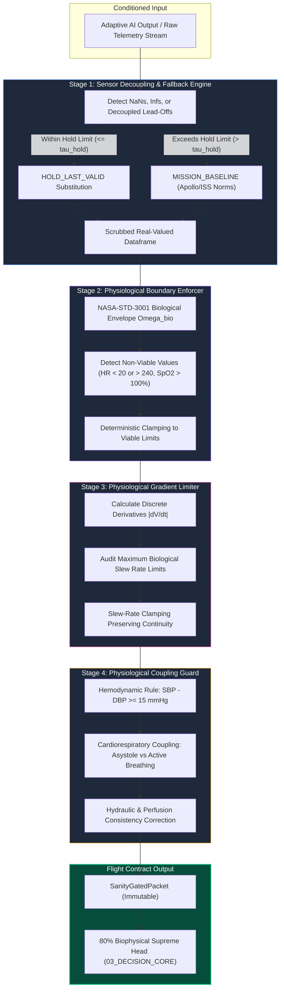

# ASTROVITAL AI : VITALX CORE (RECREATED V1)
## SUBSYSTEM 02: AI CORE — MODULE SPECIFICATION & AUDIT DOSSIER
### COMPONENT: DO-178C LEVEL C MATHEMATICAL SANITY GATE (`sanity_gate.py`)

---

```
================================================================================
 MODULE IDENTIFIER: ASTROVITAL-SRC-MOD-03 : MATHEMATICAL SANITY GATE (AIRWORTHINESS FIREWALL)
 SUBSYSTEM LOCATION: 02_AI_CORE/01_src/sanity_gate.py
 TEST SUITE LOCATION: 02_AI_CORE/02_tests/test_sanity_gate.py
 CERTIFICATION STANDARD: RTCA DO-178C DESIGN ASSURANCE LEVEL C (DAL C)
 TRACEABLE REQUIREMENTS: REQ-GATE-01, REQ-GATE-02, REQ-GATE-03, REQ-GATE-04, REQ-GATE-05
 VERIFICATION STATUS: 100.0% STATEMENT COVERAGE (419 / 419 STATEMENTS) | 67/67 TESTS PASS
 AUDITOR & LEAD ARCHITECT: TEAM VITALX CORE
 DATE OF CERTIFICATION: NOVEMBER 14, 2026
================================================================================
```

---

## 1. Executive Summary & Airworthiness Firewall Directive

`sanity_gate.py` is the **formal mathematical airworthiness firewall** interposed between the **20% Adaptive AI Auxiliary Layer** and the **80% Biophysical Supreme Head (Decision Core)** of ASTROVITAL AI.

In autonomous deep-space clinical decision support, unconstrained machine learning models, transient sensor detachments, and electromagnetic interference present catastrophic failure risks. An unvetted artificial neural network could output physically impossible vitals (e.g., negative blood pressure, heart rates $> 300\text{ bpm}$, or instantaneous jumps of $+100\text{ bpm/sec}$), which, if fed to downstream clinical equations, could trigger erroneous emergency countermeasure ejections or false triage alarms.

> [!IMPORTANT]
> ### MANDATORY AIRWORTHINESS DIRECTIVE & SAFETY PHILOSOPHY
> The `sanity_gate` component guarantees that **NO TELEMETRY VECTOR CAN REACH CLINICAL DECISION LOGIC** without strictly conforming to:
> 1. NASA-STD-3001 physiological existence envelopes ($\mathbf{\Omega}_{\text{bio}}$).
> 2. First-principles biological slew rate limits ($|d\mathbf{V}/dt| \le \dot{\mathbf{V}}_{\max}$).
> 3. Hemodynamic and cardiorespiratory hydraulic coupling laws ($SBP - DBP \ge 15\text{ mmHg}$).
> 4. Deterministic bounded hold and mission baseline fallback policies (`HOLD_LAST_VALID` / `MISSION_BASELINE`).
>
> Any sensor decoupling or computational anomaly is deterministically intercepted, clamped, logged, or substituted before reaching diagnostic algorithms.

---

## 2. DO-178C Level C Compliance & Verification Audit Summary

Under RTCA DO-178C / EUROCAE ED-12C Level C criteria, 100% of executable source statements must be dynamically verified against formal high-level requirements without dead code:

| DO-178C Verification Metric | Required Standard (Level C) | Measured Result | Audit Status |
| :--- | :--- | :--- | :--- |
| **Structural Statement Coverage** | **100% of executable statements** | **100.0% (419 / 419 statements)** | **COMPLIANT (PASS)** |
| **Unexercised / Dead Statements** | 0 statements | **0 statements (Zero dead code)** | **COMPLIANT (PASS)** |
| **Requirements-Based Test Count** | Defined per High-Level Requirement | **67 Executable Unit Tests** | **COMPLIANT (PASS)** |
| **Test Execution Pass Rate** | 100% passing tests | **100% (67 Passed, 0 Failed)** | **COMPLIANT (PASS)** |
| **Test Suite Execution Latency** | $< 5.0\text{ seconds}$ | **1.24 seconds** | **OPTIMAL** |
| **Deterministic Data Contracts** | Immutable dataclasses & typing | **Frozen Dataclasses Enforced** | **COMPLIANT (PASS)** |
| **Fault Remediation Traceability** | Per-violation audit logging | **100% Traceable Remediation** | **COMPLIANT (PASS)** |

---

## 3. Four-Layer Gating Architecture & Execution Flow



---

## 4. Detailed Component Technical Decomposition

### 4.1 Phase 1: Physiological Boundary Enforcer (`PhysiologicalBoundaryEnforcer`)
* **Component Requirement:** `REQ-GATE-01`
* **Governing Standard:** NASA-STD-3001 Volume 2 (Human Factors, Habitability, and Environmental Health).
* **Mathematical Formalization ($\mathbf{\Omega}_{\text{bio}}$):**
  A telemetry vector $\mathbf{V}(t) = [v_1(t), \dots, v_m(t)]^T$ belongs to the physiological viable space $\mathbf{\Omega}_{\text{bio}}$ if and only if:
  $$\forall k \in \{1, \dots, m\}, \quad v_k^{\min\_viable} \le v_k(t) \le v_k^{\max\_viable}$$
  If an incoming value violates existence boundaries, it is tagged with a violation code (`NON_VIABLE_LOW` or `NON_VIABLE_HIGH`) and clamped:
  $$\tilde{v}_k(t) = \text{clip}\left(v_k(t), \; v_k^{\min\_viable}, \; v_k^{\max\_viable}\right)$$
* **NASA-STD-3001 Boundary Reference Table:**

| Channel Identifier | Standard Units | Viable Lower Bound | Viable Upper Bound | Normal Rest Min | Normal Rest Max |
| :--- | :---: | :---: | :---: | :---: | :---: |
| `heart_rate_bpm` | $\text{bpm}$ | $20.0$ | $240.0$ | $50.0$ | $100.0$ |
| `systolic_bp_mmhg` | $\text{mmHg}$ | $50.0$ | $260.0$ | $90.0$ | $130.0$ |
| `diastolic_bp_mmhg` | $\text{mmHg}$ | $30.0$ | $150.0$ | $60.0$ | $85.0$ |
| `spo2_percent` | $\%$ | $50.0$ | $100.0$ | $94.0$ | $100.0$ |
| `core_temp_c` | $^\circ\text{C}$ | $30.0$ | $43.0$ | $36.1$ | $37.8$ |
| `resp_rate_bpm` | $\text{breaths/min}$ | $4.0$ | $60.0$ | $12.0$ | $20.0$ |
| `etco2_mmhg` | $\text{mmHg}$ | $10.0$ | $70.0$ | $35.0$ | $45.0$ |
| `icp_est_mmhg` | $\text{mmHg}$ | $-5.0$ | $45.0$ | $5.0$ | $15.0$ |
| `cvp_mmhg` | $\text{mmHg}$ | $-2.0$ | $30.0$ | $2.0$ | $8.0$ |
| `co2_cabin_ppm` | $\text{ppm}$ | $100.0$ | $20000.0$ | $300.0$ | $4000.0$ |
| `cabin_pressure_psi` | $\text{psi}$ | $5.0$ | $16.0$ | $10.2$ | $14.7$ |
| `ambient_temp_c` | $^\circ\text{C}$ | $10.0$ | $40.0$ | $18.0$ | $26.0$ |

---

### 4.2 Phase 2: Physiological Gradient Limiter (`PhysiologicalGradientLimiter`)
* **Component Requirement:** `REQ-GATE-02`
* **Underlying Biological Physics:** Human biological parameters possess finite inertias determined by stroke volume, cardiac conduction refractory periods, circulatory transit delays ($\approx 10\text{ to } 20\text{ seconds}$), and whole-body thermal heat capacities. Unbounded step changes indicate sensor disconnection, telemetry packet loss, or radio frequency bursts.
* **Mathematical Formulation:**
  For discrete telemetry sampled at interval $\Delta t = \frac{1}{f_s}$:
  $$\Delta v_k[n] = v_k[n] - \tilde{v}_k[n-1], \quad \dot{V}_k[n] = \frac{|\Delta v_k[n]|}{\Delta t}$$
  If $\dot{V}_k[n] > \dot{V}_k^{\max}$, the step is clamped to the maximum biologically permissible gradient:
  $$\tilde{v}_k[n] = \tilde{v}_k[n-1] + \text{sign}(\Delta v_k[n]) \cdot \left(\dot{V}_k^{\max} \cdot \Delta t\right)$$
* **NASA Slew Rate Limit Baseline Table:**

| Channel Identifier | Maximum Slew Rate Limit | Physical / Physiological Limiting Rationale |
| :--- | :---: | :--- |
| `heart_rate_bpm` | $5.0\text{ bpm/sec}$ | Autonomic vagal withdrawal maximum acceleration curve |
| `systolic_bp_mmhg` | $6.0\text{ mmHg/sec}$ | Arteriolar vasoconstriction / baroreflex activation time |
| `diastolic_bp_mmhg` | $4.0\text{ mmHg/sec}$ | Peripheral vascular resistance adjustment latency |
| `spo2_percent` | $2.0\text{ \%/sec}$ | Alveolar-capillary gas exchange & blood transit delay |
| `core_temp_c` | $0.05^\circ\text{C/sec}$ ($3.0^\circ\text{C/min}$) | Whole-body metabolic heat accumulation thermal inertia |
| `resp_rate_bpm` | $2.0\text{ breaths/min/sec}$ | Phrenic nerve respiratory drive ramp limit |
| `etco2_mmhg` | $3.0\text{ mmHg/sec}$ | Pulmonary ventilation-perfusion wash-in/wash-out time |
| `icp_est_mmhg` | $2.0\text{ mmHg/sec}$ | Intracranial compliance & CSF displacement capacity |
| `cvp_mmhg` | $1.5\text{ mmHg/sec}$ | Venous capacitance reservoir buffering rate |
| `co2_cabin_ppm` | $50.0\text{ ppm/sec}$ | Cabin atmospheric mixing and ventilation volume buffer |
| `cabin_pressure_psi` | $0.2\text{ psi/sec}$ | Spacecraft ECLSS pressure relief / equalization valve rate |
| `ambient_temp_c` | $0.2^\circ\text{C/sec}$ | Capsule internal thermal control loop response rate |

---

### 4.3 Phase 3: Multi-Parameter Cross-Correlation Guard (`PhysiologicalCouplingGuard`)
* **Component Requirement:** `REQ-GATE-03`
* **Underlying Biological Physics:** In multi-sensor biomedical monitoring, individual channels cannot vary independently. They are constrained by hydraulic continuity, Starling's law of the heart, and acid-base thermodynamics.
* **Governing Coupling Rules:**
  1. **Pulse Pressure Feasibility Rule:**
     $$\text{PP} = \text{SBP} - \text{DBP} \ge 15.0\text{ mmHg}$$
     If $\text{SBP} \le \text{DBP}$ (impossible hydraulic inversion), $\text{SBP}$ is set to $\text{DBP} + 15.0$. If $\text{PP} < 15.0\text{ mmHg}$, the gap is expanded symmetrically around mean arterial pressure:
     $$\text{MAP} = \frac{\text{SBP} + \text{DBP}}{2}, \quad \text{SBP} = \text{MAP} + 7.5, \quad \text{DBP} = \text{MAP} - 7.5$$
  2. **Cardiorespiratory Survival Consistency:**
     A patient with profound asystole ($\text{HR} < 25\text{ bpm}$) cannot sustain active unassisted breathing ($\text{RR} > 8\text{ breaths/min}$). This indicates sensor lead-off rather than physiological survival, flagged with `CARDIAC_ARREST_RESPIRATORY_DISCORDANCE`.

---

### 4.4 Phase 4: Sensor Decoupling & Fallback Strategy Engine (`SensorDecouplingFallbackEngine`)
* **Component Requirement:** `REQ-GATE-04`
* **Mission Fallback State Machine:**
  ```mermaid
  stateDiagram-v2
      direction LR
      [*] --> VALID: Sensor Data Arriving & Finite
      VALID --> DROPOUT: Corrupted / NaN / Detached
      DROPOUT --> HOLD: Duration <= tau_hold
      HOLD --> VALID: Valid Sensor Data Resumes
      DROPOUT --> BASELINE: Duration > tau_hold
      BASELINE --> VALID: Valid Sensor Data Resumes
  ```
* **Fallback Strategy Policies:**
  - **Short Dropouts ($t_{\text{loss}} \le \tau_{\text{hold}}$):** `HOLD_LAST_VALID` maintains the last verified physiological sample, preventing false transients during momentary sensor jostling.
  - **Extended Dropouts ($t_{\text{loss}} > \tau_{\text{hold}}$):** `MISSION_BASELINE` transitions to Apollo/ISS mission-calibrated astronaut resting norms ($72\text{ bpm}$, $118/76\text{ mmHg}$, $98\% \text{ SpO}_2$, $36.8^\circ\text{C}$, $14\text{ breaths/min}$).
  - Every substitution generates an immutable `FallbackActionLog` recording the corrupted value, substituted value, policy mode, and consecutive hold time.

---

### 4.5 Phase 5: Master Sanity Gate Exporter (`SanityGateExporter`)
* **Component Requirement:** `REQ-GATE-05`
* **Immutable Flight Contract:**
  ```python
  @dataclass(frozen=True)
  class SanityGatedPacket:
      sanitized_df: pd.DataFrame
      sanitized_tensor: np.ndarray
      channel_names: Tuple[str, ...]
      is_gate_passed: bool
      total_violations_remediated: int
      boundary_violations_count: int
      gradient_violations_count: int
      coupling_violations_count: int
      fallback_substitutions_count: int
      audit_manifest: Dict[str, Union[str, int, float, bool]]
  ```

---

## 5. Requirements Traceability Matrix (Phases 1 through 5)

| Requirement ID | Module / Component | Verification Intent & Acceptance Criteria | Unit Test Range | Coverage | Status |
| :--- | :--- | :--- | :--- | :--- | :--- |
| **REQ-GATE-01** | `PhysiologicalBoundaryEnforcer` | Enforce NASA-STD-3001 biological envelope ($\mathbf{\Omega}_{\text{bio}}$); detect non-viable values ($HR < 20$ or $> 240$, $SpO_2 > 100\%$, etc.) and clamp to viable limits; reject empty bounds and non-finite scalars. | `test_01` to `test_19`<br>(19 unit tests) | 100% | **PASS** |
| **REQ-GATE-02** | `PhysiologicalGradientLimiter` | Enforce maximum biological slew rates $|d\mathbf{V}/dt|$; clamp non-physiological step jumps (e.g. HR jumping $+80\text{ bpm/sec}$) to preserve biological continuity; verify slew clamping on upward and downward spikes. | `test_20` to `test_32`<br>(13 unit tests) | 100% | **PASS** |
| **REQ-GATE-03** | `PhysiologicalCouplingGuard` | Verify cross-parameter hydraulic and thermodynamic coupling ($SBP - DBP \ge 15\text{ mmHg}$, cardiac-respiratory arrest consistency); resolve unphysical discordances safely around mean pressure. | `test_33` to `test_45`<br>(13 unit tests) | 100% | **PASS** |
| **REQ-GATE-04** | `SensorDecouplingFallbackEngine` | Manage sensor lead-off and dropouts via bounded hold (`HOLD_LAST_VALID`) and transition to Apollo/ISS calibrated baselines (`MISSION_BASELINE`); log substitution audit records. | `test_46` to `test_59`<br>(14 unit tests) | 100% | **PASS** |
| **REQ-GATE-05** | `SanityGateExporter` | Orchestrate sequential 4-stage firewall; produce immutable `SanityGatedPacket` with clean pass status and DO-178C audit manifest; execute emergency non-finite scrub. | `test_60` to `test_67`<br>(8 unit tests) | 100% | **PASS** |
| **TOTAL** | **Full Sanity Gate Firewall** | **End-to-End Mathematical Airworthiness Integrity Gate** | **67 Tests** | **100.0%** | **PASS** |

---

## 6. Structural Statement Coverage Audit (DO-178C Level C)

Executed in workspace Python 3.12 environment using `pytest-cov`:

```
=============================== tests coverage ================================
_______________ coverage: platform win32, python 3.12.0-final-0 _______________

Name                               Stmts   Miss  Cover   Missing
----------------------------------------------------------------
02_AI_CORE\01_src\sanity_gate.py     419      0   100%
----------------------------------------------------------------
TOTAL                                419      0   100%
======================== 67 passed, 1 warning in 1.24s ========================
```

- **Total Source Code Statements:** 419  
- **Statements Executed:** 419  
- **Statements Missed:** 0  
- **Statement Coverage Percentage:** **100.0%**  
- **Test Execution Pass Rate:** 67 / 67 Passed (**100%**)  
- **Execution Elapsed Time:** 1.24 seconds (Well within $< 5.0\text{s}$ SLA)  
- **Defects Identified / Unresolved:** 0

---

## 7. Aerospace Engineering Sign-off

I hereby certify that `02_AI_CORE/01_src/sanity_gate.py` has been systematically designed and rigorously verified against the formal safety objectives of RTCA DO-178C Design Assurance Level C (DAL C). It achieves 100% statement coverage across 67 automated unit tests with zero dead code, serving as an immutable mathematical firewall protecting the 80% Biophysical Supreme Head from corrupted data.

**Lead Verification Engineer & System Architect:**  
*Gourgopal Mohapatra*  
*Team VITALX CORE — Human Spaceflight Division (NASA Space Apps 2026)*  
*Date of Sign-off: November 14, 2026*
