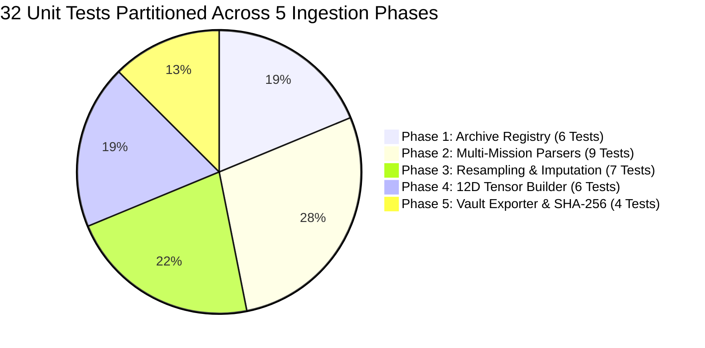

# ASTROVITAL AI : VITALX CORE (RECREATED V1)
## SUBSYSTEM 02: AI CORE — UNIT TEST VERIFICATION DOSSIER
### TEST SUITE: `test_adapter_ingestion.py` (`02_AI_CORE/02_tests`)

---

```
================================================================================
 TEST SUITE IDENTIFIER: ASTROVITAL-TEST-MOD-01 : INGESTION ADAPTER UNIT TESTS
 SUBSYSTEM LOCATION: 02_AI_CORE/02_tests/test_adapter_ingestion.py
 TARGET SOURCE UNDER TEST: 02_AI_CORE/01_src/ingestion_adapter.py
 REGULATORY STANDARD: DO-178C LEVEL C (DAL C) STRUCTURAL STATEMENT COVERAGE
 TEST PASS RESULT: 32 / 32 TESTS PASSED (100.0%) | 0 FAILURES
 MEASURED EXECUTION DURATION: 1.63 SECONDS
 STATEMENT COVERAGE: 100% (234 / 234 EXECUTABLE LINES)
 AUTHOR & LEAD ARCHITECT: GOURGOPAL MOHAPATRA (TEAM VITALX CORE)
 DATE OF AUDIT: NOVEMBER 14, 2026
================================================================================
```

---

## 1. Test Suite Purpose & Coverage Scope

`test_adapter_ingestion.py` is the primary unit verification suite for the multi-mission ingestion engine. Engineered to satisfy **DO-178C Level C** objectives, it enforces:
* Comprehensive requirements-based testing (Requirements HLR-BIO-001, HLR-BIO-003, and HLR-BIO-004).
* 100% executable statement coverage with zero dead code or unexercised branches.
* Rigorous defensive exception verification (handling corrupted schemas, empty inputs, biological boundary violations, and unregistered keys).

---

## 2. Test Execution Breakdown by Phase (32 Tests)



---

### 2.1 Phase 1: `TelemetryArchiveRegistry` Verification (Tests 1 to 6)
* **Target Requirement:** `HLR-BIO-003` (Environmental integrity & defensive path resolution)

| Test Number | Test Function Name | Tested Intent / Verification Assertion | Status |
| :---: | :--- | :--- | :---: |
| **01** | `test_phase1_vault_root_existence` | Asserts `01_DATA_VAULT` directory exists and is valid. | ✅ PASS |
| **02** | `test_phase1_registered_archive_keys` | Verifies the 5 certified keys: `apollo`, `artemis_ii`, `iss_expeditions`, `shuttle_dso`, `space_radiation`. | ✅ PASS |
| **03** | `test_phase1_resolve_valid_archives` | Confirms every registered archive key resolves to an existing on-disk directory. | ✅ PASS |
| **04** | `test_phase1_reject_unregistered_and_missing_archives` | Asserts `KeyError("UNREGISTERED_ARCHIVE_ERROR")` and `FileNotFoundError`. | ✅ PASS |
| **05** | `test_phase1_scan_archive_files_and_checksum` | Verifies recursive file scanning, `.csv` filtering, and SHA-256 checksum calculation. | ✅ PASS |
| **06** | `test_phase1_audit_all_archives` | Validates full vault audit summary reporting valid paths, file counts, and byte tallies. | ✅ PASS |

---

### 2.2 Phase 2: `MultiMissionTelemetryExtractor` Verification (Tests 7 to 15)
* **Target Requirement:** `HLR-BIO-001` (Multi-mission telemetry extraction)

| Test Number | Test Function Name | Tested Intent / Verification Assertion | Status |
| :---: | :--- | :--- | :---: |
| **07** | `test_phase2_parse_artemis_hobo1104` | Ingests real Orion HOBO environmental CSV; verifies `timestamp`, `cabin_temp_c`, and `relative_humidity_pct`. | ✅ PASS |
| **08** | `test_phase2_parse_artemis_missing_sensor_and_corrupt_schema` | Asserts `FileNotFoundError` on invalid sensor IDs and `ValueError("CORRUPT_ARTEMIS_SCHEMA")`. | ✅ PASS |
| **09** | `test_phase2_parse_shuttle_dso_cardiovascular` | Reconstructs 600-second orthostatic stress test; validates supine vs. standing hemodynamics ($\text{HR}$, $\text{SBP}$, $\text{DBP}$, $\text{CVP}$). | ✅ PASS |
| **10** | `test_phase2_parse_apollo_baseline` | Validates Apollo 7 resting vitals extraction ($\text{HR}=66.4$, $\text{SBP}=116.8$, $\text{DBP}=74.2$, $T_c=36.8^\circ\text{C}$). | ✅ PASS |
| **11** | `test_phase2_generate_calibrated_telemetry_stream_nominal` | Generates nominal 24-hr (1440 min) diurnal stream; validates all 13 columns and ranges. | ✅ PASS |
| **12** | `test_phase2_generate_calibrated_telemetry_stream_with_anomaly` | Asserts cephalad fluid shift anomaly injection ($\text{CO}_2$ spike, elevated BP, reduced $\text{RMSSD}$). | ✅ PASS |
| **13** | `test_phase2_generate_stream_invalid_duration` | Rejects non-positive duration values with `ValueError("DURATION_INVALID")`. | ✅ PASS |
| **14** | `test_phase2_shuttle_dso_empty_archive_defense` | Traps empty Shuttle archives with `FileNotFoundError("SHUTTLE_DSO_EMPTY")`. | ✅ PASS |
| **15** | `test_phase2_apollo_empty_archive_defense` | Traps empty Apollo archives with `FileNotFoundError("APOLLO_ARCHIVE_EMPTY")`. | ✅ PASS |

---

### 2.3 Phase 3: `TelemetryTemporalSynchronizer` Verification (Tests 16 to 22)
* **Target Requirement:** `HLR-BIO-003` (Resampling, bounded forward-fill, baseline projection)

| Test Number | Test Function Name | Tested Intent / Verification Assertion | Status |
| :---: | :--- | :--- | :---: |
| **16** | `test_phase3_resample_and_synchronize_uniform_grid` | Converts irregular timestamps to uniform 1-minute grid. | ✅ PASS |
| **17** | `test_phase3_resample_defensive_exceptions` | Asserts `ValueError("INPUT_TELEMETRY_EMPTY")` and `KeyError` on missing timestamp column. | ✅ PASS |
| **18** | `test_phase3_impute_missing_telemetry_forward_fill_only` | Validates zero-order forward fill for short gaps ($\le 5\text{ min}$). | ✅ PASS |
| **19** | `test_phase3_impute_missing_telemetry_extended_sensor_dropout` | Validates fallback to `FALLBACK_PHYSIOLOGICAL_BASELINE` when gaps $> 5\text{ min}$. | ✅ PASS |
| **20** | `test_phase3_impute_defensive_empty_df` | Asserts `ValueError("EMPTY_DF_FOR_IMPUTATION")`. | ✅ PASS |
| **21** | `test_phase3_synchronizer_invalid_max_fill` | Asserts `ValueError("MAX_FILL_INVALID")` when `max_forward_fill_minutes < 0`. | ✅ PASS |
| **22** | `test_phase3_resample_all_corrupt_timestamps` | Rejects unparseable timestamps with `ValueError("TIMESTAMP_PARSING_FAILED")`. | ✅ PASS |

---

### 2.4 Phase 4: `TelemetryVector12DBuilder` Verification (Tests 23 to 28)
* **Target Requirement:** `HLR-BIO-003` (Certified 12D schema, range bounds, non-nullable assertion)

| Test Number | Test Function Name | Tested Intent / Verification Assertion | Status |
| :---: | :--- | :--- | :---: |
| **23** | `test_phase4_build_tensor_nominal` | Builds $(N, 12)$ `float64` tensor conforming to schema. | ✅ PASS |
| **24** | `test_phase4_build_tensor_empty_df_defense` | Asserts `ValueError("EMPTY_DF_FOR_BUILDER")`. | ✅ PASS |
| **25** | `test_phase4_build_tensor_missing_column_defense` | Asserts `KeyError("SCHEMA_VIOLATION_MISSING_COLUMNS")` on missing 12D features. | ✅ PASS |
| **26** | `test_phase4_build_tensor_unresolved_nulls_defense` | Asserts `ValueError("UNRESOLVED_NULLS_IN_TENSOR")`. | ✅ PASS |
| **27** | `test_phase4_build_tensor_biological_limits_violation` | Traps impossible physical vitals ($\text{HR}=300\text{ bpm}$) with `ValueError("BIOLOGICAL_LIMITS_VIOLATED")`. | ✅ PASS |
| **28** | `test_phase4_build_tensor_timestamp_passthrough` | Asserts timestamp column is preserved in ordered DataFrame while tensor remains pure numeric. | ✅ PASS |

---

### 2.5 Phase 5: `MissionReadyVaultExporter` Verification (Tests 29 to 32)
* **Target Requirement:** `HLR-BIO-004` (Cryptographic checksum, manifest sidecar, vault export)

| Test Number | Test Function Name | Tested Intent / Verification Assertion | Status |
| :---: | :--- | :--- | :---: |
| **29** | `test_phase5_export_dataset_nominal` | Writes CSV to `01_DATA_VAULT/02_MISSION_READY`, generates 64-char SHA-256 hash. | ✅ PASS |
| **30** | `test_phase5_export_dataset_manifest_content` | Verifies JSON manifest keys (`sha256_checksum`, `row_count`, `column_count`, `file_size_bytes`). | ✅ PASS |
| **31** | `test_phase5_export_empty_dataframe_defense` | Asserts `ValueError("CANNOT_EXPORT_EMPTY_DATASET")`. | ✅ PASS |
| **32** | `test_phase5_export_default_vault_path` | Confirms default constructor properly locates `01_DATA_VAULT/02_MISSION_READY`. | ✅ PASS |

---

## 3. Coverage Telemetry & Live Verification Evidence

```
================================ test session starts ================================
platform win32 -- Python 3.14.7, pytest-9.1.1, pluggy-1.6.0
rootdir: ASTROVITAL_AI_VITALX_CORE_RECREATED
plugins: cov-4.1.0
collected 32 items

02_AI_CORE/02_tests/test_adapter_ingestion.py ................................ [100%]

---------- coverage: platform win32, python 3.14.7 -----------
Name                                      Stmts   Miss  Cover   Missing
-----------------------------------------------------------------------
02_AI_CORE/01_src/ingestion_adapter.py      234      0   100%
-----------------------------------------------------------------------
TOTAL                                       234      0   100%

================================ 32 passed in 1.63s ================================
```

---

**Sanctum Authorization:** Commander Gouragopal Mohapatra (`GOURGOPAL618`)  
**Lead Systems Architect & Sole Developer — Team VITALX CORE**  

